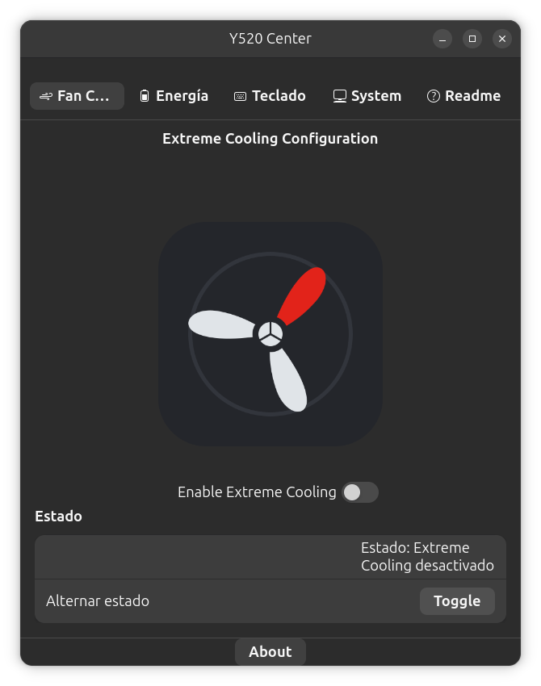
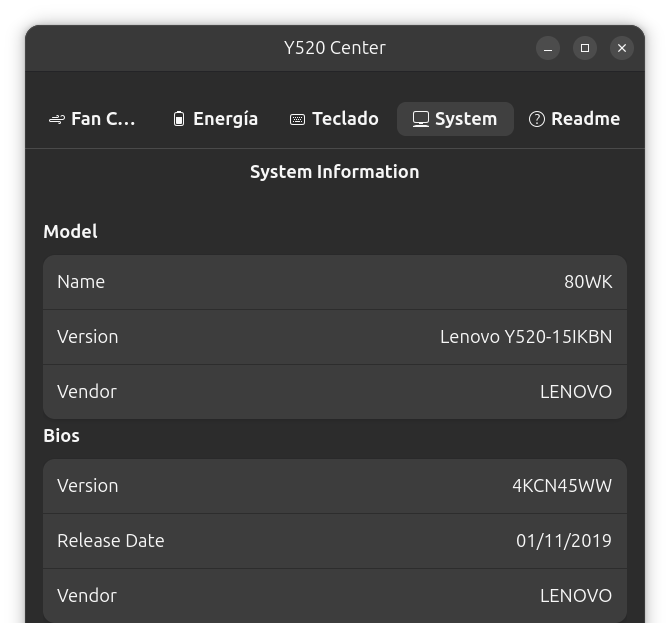
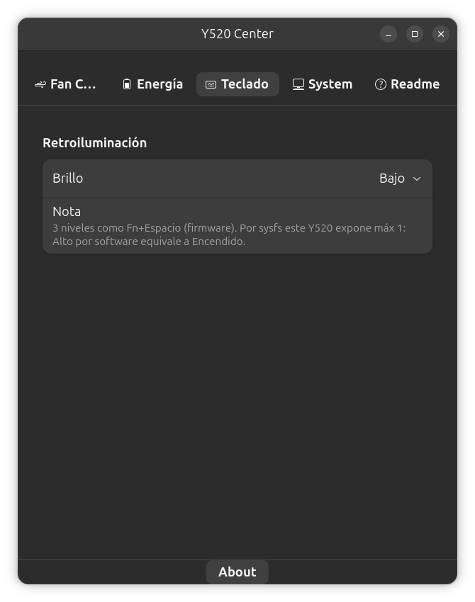
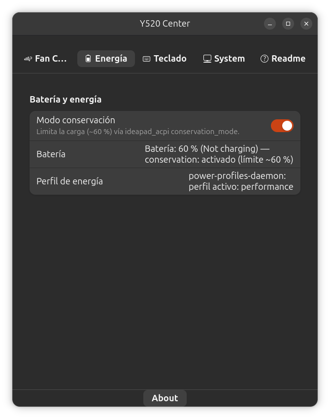
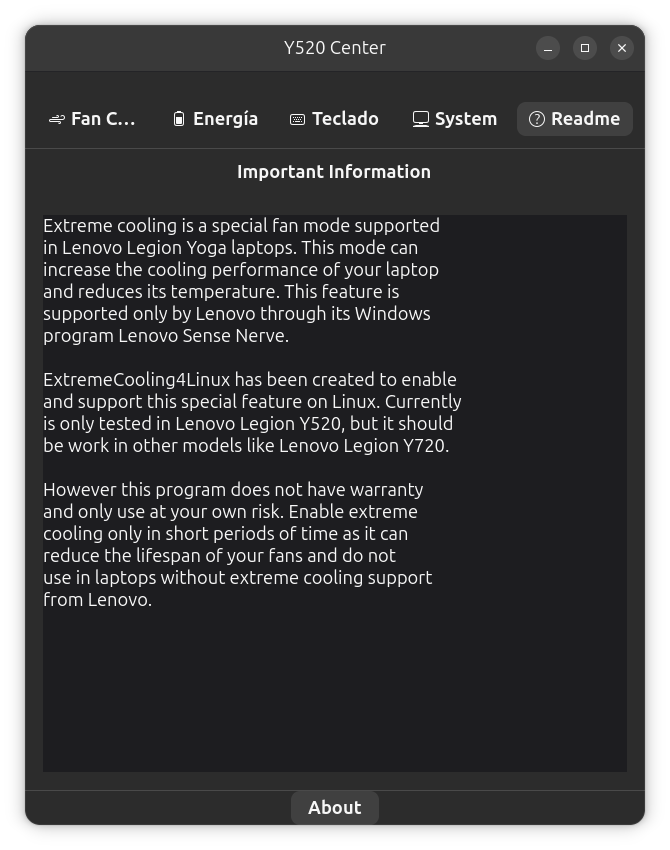

# Y520 Center


<!-- SPDX-License-Identifier: GPL-3.0-or-later -->

Centro de control nativo GNOME (GTK4 + libadwaita + GDBus/gio, C++17) para el
Lenovo Y520-15IKBN (80WK): Extreme Cooling por EC, modo de conservación de
batería, retroiluminación blanca del teclado e información del sistema.

## Pantallazos

| Fan Control | System (sensores y núcleos en vivo) | Teclado |
|---|---|---|
|  |  |  |
| Energía | Readme | |
|  |  | |

## Arquitectura

- `src/ec/Y520EC.{h,cpp}` — acceso al EC por IO ports (`0x66`/`0x62`,
  `RD_EC=0x80`, `WR_EC=0x81`, registro `0xBD`, `0x40=on`/`0x00=off`).
  Requiere root / `CAP_SYS_RAWIO` (`ioperm`).
- `src/cli/y520-cli.cpp` — CLI sin privilegios salvo IO/sysfs.
- `src/daemon/y520d.cpp` — daemon de sistema D-Bus `org.lenovo.Y520`
  (`/org/lenovo/Y520`), con check polkit; único que toca el EC como root.
- `src/gui/y520-center.cpp` — `AdwApplication org.lenovo.Y520Center` con
  páginas Enfriamiento / Energía / Teclado / Sistema. Sin daemon, muestra
  lectura sysfs directa con aviso "daemon no disponible". Nunca usa EC.
- `data/` — `org.lenovo.Y520.policy` (polkit), `org.lenovo.Y520.conf`
  (D-Bus system), `y520d.service` (systemd), `10-y520-kbd.rules` (udev
  fallback ITE), `.desktop` + `.metainfo.xml`.
- `tests/test_ec_dry.cpp` — test en seco sin hardware ni root.

## Dependencias (Ubuntu 26.04)

```sh
sudo apt update && sudo apt install -y meson ninja-build g++ pkg-config \
  libgtk-4-dev libadwaita-1-dev libpolkit-gobject-1-dev libglib2.0-dev \
  lm-sensors power-profiles-daemon
```

Solo runtime (sin `-dev`): GTK 4.22, Adwaita 1.9, GNOME Shell 50 ya verificados
en esta máquina.

## Compilar

```sh
meson setup build --prefix=/usr
ninja -C build
```

> `--prefix=/usr` es obligatorio: D-Bus, polkit y systemd solo leen rutas
> bajo `/usr` (con `/usr/local` el daemon no se registra).

## Instalar (desde fuente)

```sh
sudo meson install -C build
sudo systemctl daemon-reload
sudo systemctl enable --now y520d
# udev (solo relevante si alguna variante expone USB ITE; el Y520 verificado no):
sudo udevadm control --reload-rules && sudo udevadm trigger
```

## Instalar (desde .deb)

Cada tag `v*` genera un `.deb` en la GitHub Release (pipeline
`.github/workflows/release.yml`):

```sh
sudo dpkg -i y520-center_<versión>_amd64.deb
sudo systemctl enable --now y520d
```

Generarlo en local:

```sh
./packaging/mkdeb.sh [versión]   # sale en packaging/out/
```

## Publicar una release

```sh
git tag v0.2.0 && git push origin v0.2.0
# → GitHub Actions compila, empaqueta y adjunta el .deb a la Release
```

## Tests en seco (sin root ni hardware)

```sh
Y520_DRY=1 ./build/tests/test_ec_dry
meson test -C build
```

`Y520_DRY=1` simula el EC en memoria: `initialize()`/`ec_wait()` no tocan IO,
`ec_read`/`ec_write` operan sobre registros virtuales y `detect_supported()`
devuelve true. El daemon también acepta `Y520_DRY=1` (además relaja polkit si
PolicyKit no responde, solo en dry). El CLI acepta `Y520_CONSERVATION_PATH` y
`Y520_KBD_PATH` para redirigir sysfs en tests.

## Instalar (desde fuente)

```sh
sudo meson install -C build
sudo systemctl daemon-reload
sudo systemctl enable --now y520d
# udev (solo relevante si alguna variante expone USB ITE; el Y520 verificado no):
sudo udevadm control --reload-rules && sudo udevadm trigger
```

Destinos: binarios a `bindir` (`y520-cli`, `y520d`, `y520-center`), policy a
`/usr/share/polkit-1/actions`, conf D-Bus a `/usr/share/dbus-1/system.d`,
service a `systemdsystemunitdir`, regla udev a `udev/rules.d`, `.desktop` a
`applications` y metainfo a `metainfo`.

## Uso CLI

```sh
sudo ./build/src/cli/y520-cli check     # detecta LENOVO 80WK, lee 0xBD
y520-cli status                          # ACTIVADO / DESACTIVADO
sudo y520-cli enable|disable|toggle
y520-cli conservation status             # lee conservation_mode (VPC*)
sudo y520-cli conservation on|off
y520-cli kbd status                      # lee platform::kbd_backlight (0-2)
sudo y520-cli kbd 0|1|2
```

Códigos de retorno: 0 ok, 1 error, 2 no soportado. Mensajes en ES + EN.

## Uso GUI

```sh
./build/src/gui/y520-center
```

Réplica del `ExtremeCooling4Linux` original (ventana, pestañas Fan Control /
System / Readme, textos y About v0.3) + páginas Energía y Teclado: switch
Extreme Cooling (validación post-escritura + señal `ExtremeCoolingChanged`),
switch conservación, combo teclado Off/Bajo/Alto, System con 9 filas DMI +
temperaturas en vivo (barra + °C por sensor) + uso por núcleo en vivo
(barra + %). Autorización polkit única (`org.lenovo.Y520.manage`,
`auth_admin_keep`: una contraseña vale para todo).

## Nota teclado

El Y520-15IKBN verificado usa `platform::kbd_backlight` (blanco; el firmware
da 3 niveles con Fn+Espacio pero sysfs expone `max_brightness=1`, así que el
Alto por software equivale a Encendido) y **no** necesita la regla udev:
`lsusb | grep 048d` no muestra nada. La regla `10-y520-kbd.rules` solo da
permiso `0666`+`uaccess` a `048d:c963/c965` por si otra variante Y520 expone
el ITE.

## Licencia

GPL-3.0-or-later. Ver cabeceras SPDX en cada fuente.

## Créditos

- [kkYrusobad/ExtremeCoolingy520](https://github.com/kkYrusobad/ExtremeCoolingy520) —
  base crítica: protocolo EC (`ec4Linux.py`) portado 1:1 a C++. GPL-3.0.
- [InstinctEx/lenovo-ideapad-legion-keyboard-led](https://github.com/InstinctEx/lenovo-ideapad-legion-keyboard-led) —
  protocolo USB ITE `048d:c963` como fallback de teclado (no aplicable directo
  al Y520 verificado).
- [johnfanv2/LenovoLegionLinux](https://github.com/johnfanv2/LenovoLegionLinux) —
  arquitectura (`legion_cli`, `fan_unlock`, `conservation_mode`, PPD, hwmon).
- [cszach/linux-on-lenovo-legion](https://github.com/cszach/linux-on-lenovo-legion) —
  scripts aplicables (batería, GPU híbrida, brillo).
